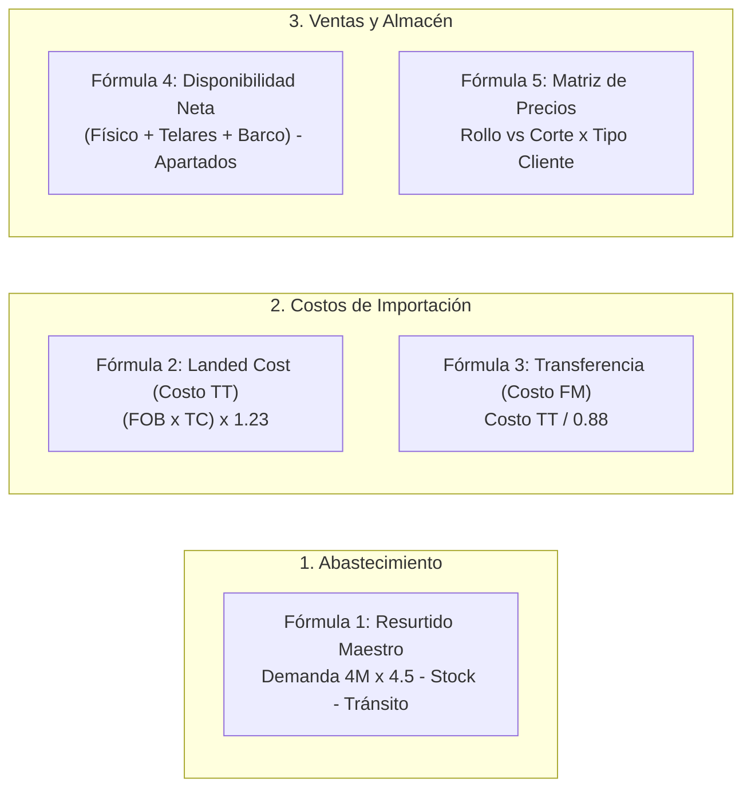

# El Funcionamiento de Formatex WMS 360°
## Del Hilo en Asia a la Sala en México: La Odisea Textil Paso a Paso

**Documento Maestro de Operaciones, Glosario Pedagógico y Reglas de Negocio**  
*Organización:* Forma Textil S. de R.L. de C.V. (Formatex) & Telares y Tejidos S.A. de C.V. (TNT)  
*Arquitectura de Software:* Movida TCI LLC  
*Versión:* 1.0 (Estructural y Evolutiva)  
*Fecha de Emisión:* Octubre de 2026  

---

## Prólogo: ¿Por qué existe este documento y cómo leerlo?

Este documento no es un manual técnico aburrido ni una lista fría de requisitos informáticos. Es la **historia viva de cómo funciona Formatex**, contada de principio a fin, para que cualquier persona que se integre a la empresa o al equipo de desarrollo entienda el negocio textil sin rodeos.

Aquí no se asume que el lector es un experto en aduanas, ni un gurú de almacenes, ni un actuario financiero. Cada término extraño (como *FOB*, *Pedimento*, *Handling Unit*, *Landed Cost* o *Backorder*) se explica con palabras sencillas y ejemplos cotidianos. 

A lo largo de este viaje, acompañaremos a un rollo de tela —desde que es hilado y teñido en las factorías textiles de China, hasta que viaja 35 días a bordo de un buque carguero cruzando el Océano Pacífico, desembarca en el Puerto de Manzanillo, se divide entre dos empresas hermanas en Guadalajara y termina tapizando los sillones de un fabricante en Arandas o un desarrollo residencial en Zapopan—.

---

## Índice General

1. [Capítulo 1: El Lenguaje Secreto de Formatex (Glosario Pedagógico)](#capítulo-1-el-lenguaje-secreto-de-formatex-glosario-pedagógico)
   - 1.1. Términos de Comercio Exterior e Importaciones
   - 1.2. Términos del Nexo Intercompañía (Telares vs. Formatex)
   - 1.3. Términos de Atención al Cliente (ATC) y Ventas
   - 1.4. Términos de Almacén y Control de Calidad
2. [Capítulo 2: El Cerebro Matemático (Fórmulas Oficiales de Formatex)](#capítulo-2-el-cerebro-matemático-fórmulas-oficiales-de-formatex)
   - 2.1. Fórmula del Resurtido Maestro (Supply Planning)
   - 2.2. Fórmula del Landed Cost (Costo TT en México)
   - 2.3. Fórmula de Transferencia Intercompañía (Costo FM)
   - 2.4. Fórmula de Disponibilidad Neta para Ventas
   - 2.5. Matriz Oficial Rollo vs. Corte y Listas F0 a F10
3. [Capítulo 3: La Odisea del Rollo Paso a Paso (Storytelling Extremo a Extremo)](#capítulo-3-la-odisea-del-rollo-paso-a-paso-storytelling-extremo-a-extremo)
   - Acto I: La Decisión de Compra y el Buque en el Pacífico (Elba y Mane)
   - Acto II: La Llamada del Cliente y el Candado de Precio (ATC y Ventas)
   - Acto III: La Danza de la Disponibilidad (Bodega Formatex, Telares y Barco)
   - Acto IV: La Handheld Zebra en Rampa (Israel y Almacén)
   - Acto V: El Candado Logístico de Ruta (Flota Propia de Camionetas)
   - Acto VI: El Cierre Fiscal y Contable (CONTPAQi y CFDI 4.0)
4. [Capítulo 4: Mapa de Roles y Accesos en la Plataforma](#capítulo-4-mapa-de-roles-y-accesos-en-la-plataforma)
5. [Capítulo 5: Hoja de Ruta para Nuevas Entrevistas (Documento Vivo)](#capítulo-5-hoja-de-ruta-para-nuevas-entrevistas-documento-vivo)

---

## Capítulo 1: El Lenguaje Secreto de Formatex (Glosario Pedagógico)

Para entender cómo funciona el software, primero hay que entender cómo habla la gente en la operación real. Aquí desglosamos los conceptos clave sin dar nada por sentado.

### 1.1. Términos de Comercio Exterior e Importaciones

* **FOB (Free On Board / Franco a Bordo):**  
  Es el precio que se le paga a la fábrica en China. Significa que el fabricante se hace responsable de la tela hasta que la sube a bordo del barco en el puerto de salida (por ejemplo, en Shanghai o Ningbo). A partir de ese momento, los riesgos y los costos del flete marítimo son de nosotros. **Ejemplo:** Si un metro de tela cuesta *$2.50 USD FOB*, ese precio aún no incluye fletes, aranceles ni seguros.
* **BL (Bill of Lading / Conocimiento de Embarque):**  
  Es el contrato de transporte y el título de propiedad de la mercancía expedido por la naviera (como MSC, Maersk o Cosco). Quien tiene el original del BL es el dueño legal del contenedor. Sin este documento, la aduana no permite tocar la carga.
* **ETA (Estimated Time of Arrival / Fecha Estimada de Arribo):**  
  El día exacto en que se calcula que el buque carguero entrará a aguas mexicanas y atracará en el muelle de Manzanillo.
* **Manzanillo (Colima):**  
  El puerto marítimo por excelencia de la costa del Pacífico mexicano por donde entra prácticamente todo el producto textil que Formatex compra en Asia.
* **Pedimento Aduanal:**  
  Es el acta de nacimiento fiscal de la mercancía en México ante el SAT. Es un documento oficial con un folio de 15 dígitos que acredita que la tela pagó todos sus impuestos de importación y se encuentra legalmente en el país.
* **Tipo de Cambio del Pedimento (¡Regla Crítica!):**  
  Cuando un contenedor llega y se pagan los impuestos en aduana, el SAT fija un tipo de cambio oficial específico en ese día. En Formatex **queda estrictamente prohibido costear inventario viejo con el dólar de hoy**. El costo de ese rollo queda congelado para siempre con el tipo de cambio que se timbró en su respectivo pedimento aduanal.
* **Landed Cost (Costo Puesto en México):**  
  Es lo que realmente costó el metro de tela ya colocado en las bodegas de Guadalajara, sumando al precio FOB de China los gastos de: flete marítimo, seguro de traslado, maniobras de grúa en puerto, almacenaje portuario, aranceles e impuestos y honorarios del agente aduanal.
* **Arancel (IGI - Impuesto General de Importación):**  
  Impuesto que cobra el gobierno mexicano para proteger la industria nacional al ingresar telas extranjeras (suele oscilar entre el 10% y el 25% dependiendo de la fracción arancelaria).
* **DTA (Derecho de Trámite Aduanero):**  
  Tasa que cobra la aduana por el servicio de procesar y validar el pedimento.

---

### 1.2. Términos del Nexo Intercompañía (Telares vs. Formatex)

Una de las particularidades más importantes del negocio es que **Formatex no está sola**, convive con una empresa hermana:

```
┌──────────────────────────────────────┐       ┌──────────────────────────────────────┐
│       TELARES Y TEJIDOS (TNT)        │       │         FORMA TEXTIL (FORMATEX)      │
├──────────────────────────────────────┤       ├──────────────────────────────────────┤
│ • Es la importadora oficial ante SAT │       │ • Es la comercializadora mayorista   │
│ • Compra los contenedores a China    │       │ • Atiende a clientes, tapiceros y ATC│
│ • Bodega nodriza masiva: RENSSELAER  │ ===>  │ • Bodega de alta rotación: LA BARCA  │
│   (Río Tototlán - Miles de rollos)   │       │   (Espacio limitado para despacho)   │
│ • Vende a Formatex con margen 7-12%  │       │ • Recibe producto fraccionado diario │
└──────────────────────────────────────┘       └──────────────────────────────────────┘
                  ▲                                               │
                  └───────── "Mismo dueño, pero cuentas claras" ──┘
                             (Se pagan y se dan el vuelto)
```

* **Telares y Tejidos S.A. de C.V. (TNT):**  
  Es la razón social que cuenta con el padrón de importadores ante el SAT. Es el "músculo importador" y dueño de la bodega matriz (Bodega Rensselaer, en calle Río Tototlán). Como puede almacenar miles de rollos, ahí llegan los contenedores pesados.
* **Forma Textil S. de R.L. de C.V. (Formatex):**  
  Es la empresa ágil de cara al cliente final, diseñadores y fabricantes de muebles. Su bodega (en calle Río La Barca) es pequeña y no puede almacenar contenedores enteros de 800 rollos. Por eso, Formatex le pide mercancía a Telares todos los días según lo que va vendiendo.
* **"Se pagan y se dan el vuelto":**  
  Aunque ambas empresas pertenecen a la misma familia y comparten a directivos clave, fiscalmente y administrativamente son entes separados. Telares le factura a Formatex con un **margen de intermediación pactado (entre el 7% y el 12%)**.
* **Orden de Traspaso Digital vs. "Captura de WhatsApp":**  
  Antes del WMS 360°, cuando Formatex necesitaba tela de Telares, alguien mandaba una foto de un papel por WhatsApp al chofer. Hoy, el sistema genera una **Orden de Traspaso Digital**, auditada, que descuenta el inventario de Rensselaer y lo da de alta en La Barca con trazabilidad total.
* **Regla del Costo Más Alto:**  
  Si en la bodega de Telares conviven rollos de *Lino Crudo* que llegaron en 2024 con flete barato ($1,800 USD/contenedor) y rollos que llegaron en 2026 con flete caro ($4,500 USD/contenedor), al transferir a Formatex **el sistema siempre toma como base el costo del embarque más reciente y alto**, protegiendo a la empresa contra desfases de rentabilidad.

---

### 1.3. Términos de Atención al Cliente (ATC) y Ventas

* **ATC (Atención al Cliente):**  
  El departamento liderado por Alma y Andrea Ramírez. Son las personas que reciben las llamadas de los clientes, capturan los pedidos, confirman las existencias y gestionan la entrega.
* **Agente de Ventas / Cartera:**  
  Los asesores comerciales que atienden a los clientes en campo o por teléfono (Luis Javier Robledo, Gabriel Navarro, Juan Pablo Hernández, Juan Manuel Casillas y Andrea Robles). Cada cliente tiene asignado a su agente para efectos de comisiones y seguimiento.
* **Rollo Completo ($\ge 50$ metros):**  
  Se considera "Venta por Rollo" cuando el cliente compra una pieza entera de fábrica (típicamente 50 metros). Esto no genera desperdicio para el almacén y por ende tiene un precio por metro más bajo.
* **Corte ($< 50$ metros):**  
  Cuando un cliente solo necesita 5, 12 o 25 metros. Como un almacenista tiene que abrir un rollo cerrado, tenderlo sobre una mesa, medirlo, cortarlo a mano con tijera o cúter y volver a empaquetar el sobrante, **el precio por metro es más elevado** para absorber la mano de obra y la merma.
* **Las 11 Listas Oficiales de Precios (F0 a F10):**  
  La jerarquía estricta de tarifas que rige a Formatex:
  * `F0`: Precio Distribuidor Máster / Gran Volumen.
  * `F1` / `F2` / `F3`: Casa Decoradora y Tiendas de Tela (`F3` requiere visto bueno gerencial).
  * `F4` / `F5`: Fabricantes de Muebles (`F5` requiere visto bueno gerencial).
  * `F6` / `F7`: Distribuidores Regionales (`F7` requiere visto bueno gerencial).
  * `F8` / `F9`: Cuentas Premium e Institucionales (`F9` requiere visto bueno de Dirección).
  * `F10`: Venta Web / E-Commerce Shopify / Menudeo.
* **Convenio Directivo / Precio Especial (`ClientSpecialPrice`):**  
  Tarifa fija negociada en persona por la Dirección General con cuentas estratégicas (por ejemplo, *7 Days Muebles*, *Almacenes Camarena* o *Muebles Plasencia*). Esta tarifa mata cualquier lista y se respeta en el sistema automáticamente.
* **Candado Infranqueable de Precios 🔒:**  
  En la pantalla de captura del WMS, la casilla donde dice el precio por metro está **bloqueada en gris**. Nadie en ATC puede tipear un número arbitrario. El sistema es quien decide el precio exacto según el cliente, el volumen y las reglas del negocio.
* **Apartado Blando (24 horas) vs. Apartado Firme (72 horas):**  
  * *Blando (Comercial):* Cuando un cliente pide que le guarden una tela mientras su cliente le confirma el color. Dura solo 24 horas. Si no paga ni deposita anticipo, el sistema libera los rollos automáticamente para que otro vendedor pueda venderlos.
  * *Firme (Almacén):* Cuando ya hay comprobante de pago o crédito autorizado. Se etiqueta con el nombre del cliente y tiene hasta 72 horas para ser despachado.
* **Backorder FIFO ("BARCORDE"):**  
  Cuando una tela no existe físicamente en Guadalajara pero ya viene en un contenedor en el mar. El cliente puede apartar rollos sobre el barco. El motor asigna lugares en una fila estricta: el primero que aparta es el primero en recibir cuando el contenedor toca tierra (FIFO: *First In, First Out*).
* **Retención "Bodega en Espera de Ruta":**  
  Candado de seguridad que evita que el almacén suba un pedido al camión si el cliente no está en su día autorizado de recepción (ejemplo: clientes de Ocotlán que solo reciben martes y jueves).

---

### 1.4. Términos de Almacén y Control de Calidad

* **HU (Handling Unit / Matrícula de Rollo):**  
  Es la "cédula de identidad" de cada rollo de tela. Es una etiqueta física con código de barras adhesiva que contiene un folio único (ej. `HU-2026-004521`). En el WMS no decimos "hay 300 metros de tela azul", decimos *"hay 6 HUs específicas de 50 metros cada una, ubicadas en el Rack A-04-Nivel 2"*.
* **Rollo Madre vs. Hijos de Corte:**  
  Si un rollo cerrado de 50 metros (`HU-01`) se abre para cortarle 12 metros a un cliente, el WMS genera una nueva matrícula para el corte entregado (`HU-01-C1` con 12m) y actualiza el saldo del rollo original (`HU-01` con 37.8m, descontando 0.2m de merma).
* **Handheld Zebra TC22:**  
  Terminal móvil de grado industrial con lector láser y pantalla táctil que usan los almacenistas de Formatex en su cinturón. Con ella escanean los rollos a 2 metros de distancia sin necesidad de escribir nada en papel.
* **Recepción Ciega:**  
  Técnica de control de inventario donde el almacenista que descarga el camión no sabe cuántos rollos se supone que vienen. Está obligado a escanear rollo por rollo; de esta manera se evitan inventarios inflados o pérdidas hormiga.

---

## Capítulo 2: El Cerebro Matemático (Fórmulas Oficiales de Formatex)

Detrás de la interfaz visual del WMS operan cinco motores matemáticos que rigen toda la toma de decisiones:



### 2.1. Fórmula del Resurtido Maestro (Supply Planning)
Dirección General y Compras utilizan esta ecuación semanalmente para saber qué y cuánto pedir a China sin sobreinventariarse ni quedarse desabastecidos:

$$\mathbf{Demanda\ Planificada} = \text{Ventas Acumuladas Últimos 4 Meses} \times 4.5$$

$$\mathbf{Sugerido\ a\ Comprar} = \mathbf{Demanda\ Planificada} - \left( \text{Stock Físico Bodegas} + \text{Tránsito en Mar} \right)$$

* **¿Por qué 4.5?**  
  Representa el factor de cobertura necesario para absorber el ciclo de reposición de Asia: 4 a 8 semanas de producción en fábrica + 5 semanas de travesía marítima y despacho aduanal + inventario de seguridad.

---

### 2.2. Fórmula del Landed Cost en México (Costo TT)
Determina el costo real final en pesos mexicanos de cada metro que Telares y Tejidos ingresa a la bodega matriz:

$$\mathbf{Costo\ Mercanc\acute{\imath}a\ (MXN)} = \text{Precio FOB (USD)} \times \text{Tipo Cambio Oficial Pedimento}$$

$$\mathbf{Costo\ TT\ (Puesto\ en\ M\acute{e}xico)} = \mathbf{Costo\ Mercanc\acute{\imath}a\ (MXN)} \times 1.23$$

* **¿Qué significa el multiplicador 1.23?**  
  Agrupa de forma paramétrica los gastos incrementables obligatorios de importación textil:
  * $10\%$ a $15\%$ de Arancel de Importación (IGI).
  * $5\%$ a $8\%$ de Flete Marítimo Internacional y Póliza de Seguro.
  * $2\%$ a $3\%$ de Maniobras de Puerto en Manzanillo, DTA y Honorarios de Agencia Aduanal.

---

### 2.3. Fórmula de Transferencia Intercompañía (Costo FM)
Es el precio formal al cual Telares y Tejidos le factura la tela a Formatex:

$$\mathbf{Costo\ FM\ (Factura\ Formatex)} = \frac{\mathbf{Costo\ TT}}{0.88}$$

* **¿Por qué dividir entre 0.88?**  
  Garantiza un **margen de intermediación intercompañía exacto del 12%** a favor de Telares y Tejidos:
  $$\frac{\text{Costo TT}}{1 - 0.12} = \frac{\text{Costo TT}}{0.88}$$
  *(Si el margen acordado es del 8%, se divide entre $0.92$)*.

---

### 2.4. Fórmula de Disponibilidad Neta para Ventas
Lo que la pantalla de ATC muestra en verde cuando un cliente llama cotizando tela:

$$\mathbf{Disponibilidad\ Neta} = \Big( \text{Stock La Barca} + \text{Stock Rensselaer} + \text{Tr\acute{a}nsito\ Mar\acute{\imath}timo} \Big) - \Big( \text{Apartados\ 72h} + \text{Backorders\ Barco} \Big)$$

Si la Disponibilidad Neta da cero o negativo, el sistema le impide al vendedor prometer entrega inmediata.

---

### 2.5. Matriz Oficial de Precios Rollo vs. Corte
El WMS mapea el tipo de cliente comercial y el volumen del pedido de forma automática:

| Tipo Cliente | Perfil de Cliente | Lista si Pedido $\ge 50$m (Rollo) | Lista si Pedido $< 50$m (Corte) | Nivel de Candado |
| :---: | :--- | :---: | :---: | :---: |
| **PG** | Público General / Web | `F0` | `F1` | Estándar |
| **CD** | Casa Decoradora / Interiorista | `F2` | `F3` | Requiere Visto Bueno si aplica F3 |
| **T** | Tienda de Telas Tradicional | `F3` | `F2` | Requiere Visto Bueno si aplica F3 |
| **XT** | Tienda de Gran Volumen | `F4` | `F3` | Requiere Visto Bueno si aplica F3 |
| **F** | Fabricante de Muebles | `F5` | `F3` | Requiere Visto Bueno si aplica F5 |
| **XF** | Fabricante Especial (ej. 7 Days) | `F5` | `F4` | Requiere Visto Bueno si aplica F5 |
| **D** | Distribuidor Regional | `F6` | `F7` | Requiere Visto Bueno si aplica F7 |
| **P** | Cliente Premium Institucional | `F8` | `F9` | Requiere Visto Bueno Dirección |
| **CE** | Cuenta Especial / Shopify Web | `F10` | `F10` | Estándar |

---

## Capítulo 3: La Odisea del Rollo Paso a Paso (Storytelling Extremo a Extremo)

Para ver cómo todos los módulos del WMS trabajan como una orquesta afinada, sigamos el ciclo de vida real de un pedido típico:

---

### Acto I: La Decisión de Compra y el Buque en el Pacífico
*Personajes: Ricardo Zerpa (Dirección), Elba Vázquez (Compras) y Mane Gómez (Tráfico)*

1. Es lunes por la mañana. Ricardo y Elba abren el módulo de **Plan de Resurtido (`/planificacion`)**. El sistema ejecutó el algoritmo nocturno sobre los 1,499 SKUs y detectó que la tela **`LENIGIRO` (ENIGMA IRON)** tiene una demanda proyectada de 1,200 metros para los próximos meses, pero en bodega solo quedan 300 metros.
2. Elba genera con un clic la **Orden de Compra Internacional** por 1,000 metros (20 rollos cerrados de 50m) con la fábrica textil en China, pactando un precio de **$2.80 USD/m FOB**.
3. Cuatro semanas después, la fábrica termina de hilar la tela. Mane Gómez recibe el **Packing List** del proveedor y coordina con la naviera la carga en el contenedor **`MSCU-829104-1`**. 
4. Mane ingresa al módulo de **Tránsito & Costeo (`/transito`)** y actualiza el estado a `ZARPADO_EN_TRANSITO`, registrando el buque *MSC CAPELLA*, número de contenedor y su **ETA a Manzanillo: 2 de Noviembre**.
5. Desde ese segundo, todo el equipo de ventas en Guadalajara puede ver que vienen 1,000 metros navegando en el mar.

---

### Acto II: La Llamada del Cliente y el Candado de Precio
*Personajes: Luis Javier Robledo (Agente de Ventas) y Andrea Ramírez (ATC)*

1. Tres semanas después, mientras el buque navega a mitad del Océano Pacífico, el comprador de **7 DAYS MUEBLES** en Arandas llama a su asesor comercial, Luis Javier Robledo:  
   *—"Luis Javier, ganamos un contrato para amueblar un hotel boutique. Necesito 700 metros urgentes de ENIGMA IRON para tapicería."*
2. Luis Javier se comunica con ATC. Andrea Ramírez abre la pantalla de **Nuevo Pedido (`/pedidos`)**.
3. Andrea busca al cliente: `7 DAYS MUEBLES (RFC: XFSADOJO)`.
4. El sistema autocompleta al instante:
   * Vendedor asignado: **Luis Javier Robledo (`VEND-LJR`)**.
   * Tipo de cliente: **`XF` (Fabricante Especial)**.
   * Domicilio de entrega: *Carretera Arandas-Tepatitlán Km 4.5, Bodega 2, Arandas, Jalisco*.
   * Días autorizados de entrega: **Martes y Jueves (Ruta Ocotlán/Altos)**.
5. Andrea añade la línea: SKU `LENIGIRO` por **700 metros**.
6. **El Candado de Precios actúa:**
   * La cantidad (700m) supera los 50m $\rightarrow$ activa la tarifa de **Rollo Completo**.
   * Al ser tipo `XF`, el motor asigna la lista **`F5`** ($185.00 MXN/m) o consulta si tiene un **Convenio Directivo** vigente.
   * La casilla de precio queda **bloqueada con un candado 🔒 (`readOnly`)**. Andrea no puede alterarla ni por equivocación.

---

### Acto III: La Danza de la Disponibilidad
*Personajes: El Motor de Disponibilidad del WMS*

El cliente necesita 700 metros (14 rollos de 50m). El WMS analiza los inventarios en milisegundos y resuelve la demanda en tres niveles:

```
                          DEMANDA: 700 METROS
                                   │
         ┌─────────────────────────┼─────────────────────────┐
         ▼                         ▼                         ▼
   300 METROS                 100 METROS                300 METROS
Nave Formatex (NAV-001)   Bodega Telares (BOD-TNT)   Tránsito Marítimo (Barco)
 (Río La Barca - GDL)     (Río Tototlán / Matriz)     (Contenedor MSCU-829104-1)
         │                         │                         │
         ▼                         ▼                         ▼
 6 Rollos Físicos         Orden de Traspaso          Turno #1 Cola FIFO
 Apartados (Soft-Lock)    Digital Intercompañía       Backorder ("BARCORDE")
```

1. **Nivel 1: Almacén Formatex (`NAV-001` - Río La Barca):**
   * El sistema encuentra físicamente en rack **6 rollos completos (300 metros)**: `HU-2026-00001` a `HU-2026-00006`.
   * Les coloca un *Apartado Blando de 24 horas*.
2. **Nivel 2: Bodega Hermana Telares y Tejidos (`BOD-TNT` - Río Tototlán):**
   * El sistema detecta que en la bodega matriz de Telares hay **2 rollos disponibles (100 metros)**.
   * Genera en el módulo de `/transferencias` una **Orden Digital de Traspaso Inter-Bodegas**, notificando al chofer interno para recogerlos en su vuelta vespertina.
3. **Nivel 3: El Mar (Backorder FIFO Marítimo):**
   * Aún faltan **300 metros (6 rollos)**.
   * El sistema localiza el contenedor `MSCU-829104-1` que Mane dio de alta en `/transito` (con ETA en 12 días).
   * Registra a 7 Days Muebles como **Turno #1 en la Cola FIFO de Backorders ("BARCORDE")**. 
   * Esos 6 rollos que aún flotan en el agua quedan etiquetados con el nombre del cliente. Si otro vendedor de Formatex intenta vender ENIGMA IRON esa misma tarde, el sistema le avisará que el barco ya está comprometido.

---

### Acto IV: La Handheld Zebra en Rampa
*Personajes: Israel (Jefe de Almacén) y el equipo de recibo*

1. Doce días después, el barco atraca en Manzanillo. El agente aduanal desaduana el contenedor, liquida el pedimento y un tráiler con plataforma traslada el contenedor a Guadalajara.
2. El camión arriba al patio de maniobras de Telares. Israel toma su terminal **Zebra TC22** y abre el módulo de **Recepción (`/recepcion`)**.
3. Realiza la **Recepción Ciega**: escanea cada rollo que va bajando del camión.
4. Al escanear el rollo número 1, la Zebra emite un sonido distintivo y una pantalla ámbar:  
   **¡ROLLO COMPROMETIDO EN BACKORDER FIFO!**  
   *Cliente: 7 Days Muebles — Pedido #PED-2026-00891*.
5. La impresora térmica portátil imprime al instante la etiqueta `HU-2026-004521` con su código QR.
6. En lugar de mandar esos rollos al fondo de un rack en el tercer piso, el sistema le indica al operador: *"Colocar en Rampa de Consolidación hacia Formatex"*.

---

### Acto V: El Candado Logístico de Ruta
*Personajes: Almacén de Despacho y Choferes de Flota Propia*

1. Con los 300m de Formatex, los 100m de Telares y los 300m recién llegados de Manzanillo, el pedido de 700 metros queda completo al 100%.
2. El personal de empaque genera el **Packing List Oficial Formatex** desde el WMS, detallando cada una de las 14 HUs con su metraje exacto y peso en kilogramos.
3. Son las 3:30 PM de un día **Lunes**. El almacenista da clic en *"Enviar a Embarque"*.
4. **El Candado de Ruta interviene:**
   * El sistema revisa la ficha del cliente: *7 Days Muebles (Arandas) solo recibe Martes y Jueves*.
   * El WMS bloquea la salida y marca el pedido con el estatus:
     $$\mathbf{Bodega\ en\ Espera\ de\ Ruta\ (Retenci\acute{o}n\ Preventiva)}$$
   * Esto previene que el pedido se cargue en la camioneta que sale el lunes a Zapopan, evitando que el chofer maneje 140 km en vano y la mercancía sea rechazada en puerta.
5. El martes a las 6:30 AM, el sistema incluye automáticamente el pedido en la **Hoja de Ruta Ocotlán/Altos**. La camioneta propia de Formatex sale a carretera y entrega en Arandas dentro de la ventana de 09:00 a 14:00 horas.

---

### Acto VI: El Cierre Fiscal y Contable
*Personajes: Facturación y Finanzas*

1. El chofer recaba la firma y sello en el remito digital a través de la terminal.
2. El pedido pasa automáticamente a estatus `ENTREGADO`.
3. El módulo de facturación timbra el **CFDI 4.0** a nombre de 7 Days Muebles, desglosando los 700 metros al precio convenido.
4. Paralelamente, en el módulo de Compras e Importaciones, el sistema emite el archivo electrónico para **CONTPAQi Comercial**:
   * Registra la factura intercompañía de Telares a Formatex con el margen del 12%.
   * Actualiza el inventario contable y las pólizas de costo de ventas sin que nadie tenga que transcribir facturas a mano en Excel.

---

## Capítulo 4: Mapa de Roles y Accesos en la Plataforma

Para que nadie interfiera en las tareas de otro departamento, el WMS 360° cuenta con una matriz de permisos estricta:

| Rol de Usuario | Quiénes lo Usan | Módulos a los que Tiene Acceso | Lo que NO Puede Hacer |
| :--- | :--- | :--- | :--- |
| **`ADMIN` / `GERENCIA`** | Ricardo Zerpa, Dirección General | Acceso total a todos los módulos, reportes de rentabilidad, configuración de usuarios y márgenes. | Ninguna restricción. |
| **`DIRECTOR_COMPRAS`** | Elba Vázquez, Mane Gómez | Órdenes de Compra a China (`/compras`), Tránsito Marítimo (`/transito`), Costeo Landed, Plan de Resurtido (`/planificacion`). | No puede alterar precios de venta ni autorizar créditos a clientes. |
| **`SUPERVISOR_ATC`** | Alma | Creación de pedidos, asignación de cartera de clientes, desbloqueo de listas especiales (`F3`, `F5`, `F7`, `F9`), catálogo de clientes y domicilios. | No puede ver los costos de importación en China ni los márgenes intercompañía. |
| **`ATC_OPERATIVO`** | Andrea Ramírez, Asesores de Ventas | Captura de pedidos (`/pedidos`), consulta de disponibilidad (`/disponibilidad`), apartado de rollos. | **Precios bloqueados 🔒**. No puede modificar tarifas unitarias ni brincarse días de ruta. |
| **`ALMACEN` / `ZEBRA`** | Israel, Almacenistas, Choferes | Escaneo de rollos (Handheld `/zebra`), recepción en rampa, picking, corte de rollo, generación de Packing List y hojas de ruta. | No tiene acceso a información financiera, facturas ni precios de venta. |
| **`COBRANZA` / `FINANZAS`** | Facturación y Cuentas por Cobrar | Módulo de Cobranza (`/cobranza`), validación de pagos, facturación CFDI 4.0 y exportación a CONTPAQi. | No puede mover inventario físico ni cambiar estados de producción. |

---

## Capítulo 5: Hoja de Ruta para Nuevas Entrevistas (Documento Vivo)

Este documento es una estructura viva. A medida que avancen las entrevistas operativas con los demás actores clave, se incorporarán los siguientes capítulos:

* [ ] **Sesión Almacén & Logística Física (Israel):** Estructura exacta de pasillos y racks en Bodega La Barca, reglas de apilamiento por peso y protocolo de corte en mesa.
* [ ] **Sesión Contabilidad & Finanzas (CONTPAQi):** Especificación del layout XML/CSV para la importación automática de pólizas y catálogo de cuentas contables.
* [ ] **Sesión Flota Propia & Choferes:** Reglas de capacidad volumétrica por camioneta (m³ y kg) y liquidación de gastos de combustible y casetas.

---

*Formatex WMS 360° — Desarrollado por Movida TCI LLC para Forma Textil S. de R.L. de C.V.*  
*Guadalajara, Jalisco, México — 2026*
