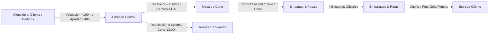
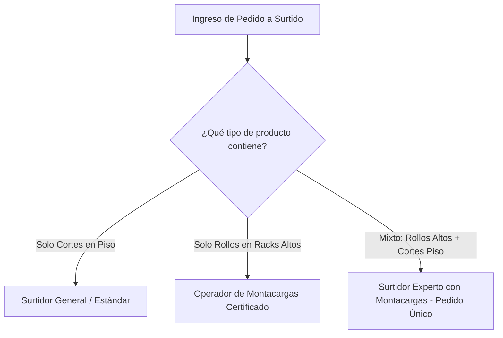
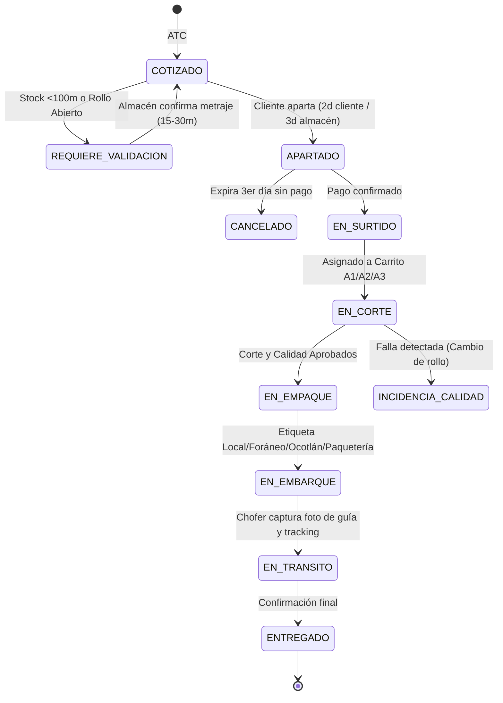

# Formatex WMS 360° — Especificación de Reglas de Negocio
## Módulo de Almacén, Surtido, Corte, Empaque, Embarques y Telares

**Fecha de Levantamiento:** Viernes, 23 de Octubre de 2026  
**Organización:** Forma Textil S. de R.L. de C.V. (Formatex)  
**Proveedor Tecnológico:** Movida TCI LLC  
**Versión:** 1.0 (Oficial Integral para Revisión, Validación y Firma)  
**Participantes en la Sesión Operativa:**
- **Israel** — Encargado de Almacén & Logística (Formatex)
- **Andrea Ramírez** — Atención al Cliente & Operaciones (Formatex)
- **Santiago** — Operaciones & Comercial (Formatex)
- **Ricardo Zerpa** — Arquitectura de Producto & Procesos (Movida TCI)
- **Jonathan Palacios** — Dirección Técnica & Desarrollo WMS (Movida TCI)

---

## 1. Propósito y Marco de Aceptación Vinculante

El presente documento recopila, formaliza y desglosa minuciosamente cada una de las **reglas operativas, fórmulas matemáticas, tiempos de promesa (SLA), capacidades de producción y flujos interdepartamentales** consensuados con la jefatura de Almacén de Formatex.

### Finalidad Operativa y Contractual:
Este documento actúa como **anexo técnico vinculante** del sistema WMS 360°. Establece con precisión matemática y quirúrgica la interacción entre **Atención al Cliente (ATC), Almacén, Mesa de Corte, Empaque, Embarques, Reparto Propio, Fleteras Externas y Reabastecimiento a Telares**, eliminando ambigüedades y asegurando que la tecnología responda con total fidelidad a la realidad del suelo de bodega.

---

## 2. Regla 1: Protocolo de Cotización y Validación de Existencia (< 100 Metros)

### 2.1. El Umbral Crítico de los 100 Metros
En el inventario textil de Formatex, cuando un SKU cuenta con **menos de 100 metros** en existencia física disponible o cuando el pedido involucra rollos abiertos (remanentes), el sistema WMS **bloquea la venta automática o apartado directo** y dispara un protocolo de validación física obligatoria en piso de bodega.

### 2.2. Modalidades de Consulta
Existen dos tipos de solicitud generadas por ATC hacia Almacén:

| Tipo de Consulta | Objetivo Comercial | Acción en Almacén | SLA Máximo |
| :--- | :--- | :--- | :---: |
| **1. Consulta de Existencia (Rápida)** | Cliente interesado prospectando viabilidad de compra. | El almacenista acude al pasillo y rack correspondiente, realiza inspección visual del rollo y confirma el metraje impreso en la etiqueta física. | **15 a 30 minutos** (Máx 1 hr) |
| **2. Cotización en Firme** | Cliente con intención de pago inmediata o pedido formal. | Se baja físicamente el rollo del rack y se traslada a la **mesa de medición** para verificar metraje exacto metro a metro, descartando discrepancias por tensión o cortes previos no registrados. | **30 a 60 minutos** |

### 2.3. Flujo en el Sistema WMS
1. ATC ingresa la solicitud en WMS; si el stock es $< 100\text{ m}$, el sistema asigna el estado `REQUIERE_VALIDACION_ALMACEN` y envía una tarea a la terminal Zebra del almacenista.
2. El almacenista inspecciona o mide, e ingresa en su terminal:
   - Metraje utilizable confirmado ($M_{\text{real}}$).
   - Lote físico actual.
   - Observaciones (ej. *"Rollo entero sin mermas"* o *"Presenta mancha en punta de 1.20 m"*).
3. El WMS actualiza la cotización en ATC y notifica a la asesora para proceder al cierre.

---

## 3. Regla 2: Políticas de Apartado Físico y Digital (2 Días Cliente vs. 3 Días Almacén)

### 3.1. La Doble Ventana de Tiempo
Para balancear la presión comercial sobre el cliente y la flexibilidad operativa de cobranza, se establece una doble ventana temporal:

$$\begin{aligned}
\mathbf{Ventana\ Externa\ (Cliente):} & \quad \mathbf{2\ \text{Días Hábiles}}\ (48\text{ horas}) \\
\mathbf{Ventana\ Interna\ (Almacén):} & \quad \mathbf{3\ \text{Días Hábiles}}\ (72\text{ horas})
\end{aligned}$$

- **Hacia el Cliente:** La cotización y los recordatorios indican que la reserva vence en **48 horas hábiles**, estimulando la transferencia bancaria urgente.
- **En Almacén:** El sistema mantiene el rollo bloqueado durante **72 horas hábiles** (3 días). Esto previene que si un cliente paga la mañana del tercer día (muy común en ciclos administrativos de clientes corporativos), su tela ya haya sido asignada a otro comprador.

### 3.2. Etiquetado Físico en Bodega
- Al crearse el apartado en WMS, se genera automáticamente una tarea de impresión de **Marbete de Apartado**.
- El almacenista coloca el marbete físico en el rollo en su rack:
  - Texto visible: `APARTADO - PROHIBIDA SU VENTA`
  - Número de Cotización / Pedido
  - Nombre del Cliente
  - Fecha y hora exacta de vencimiento interno (72h)
- **Desapartado Automático:** Al expirar las 72 horas sin confirmación de pago de Tesorería, el WMS libera automáticamente el inventario a `DISPONIBLE`, cancela la reserva y genera una alerta en la Zebra para el retiro del marbete físico.

---

## 4. Regla 3: Capacidad Operativa y Asignación de Surtido por Altura y Especialidad

### 4.1. Métrica de Productividad Homologada
- **Capacidad estándar por surtidor:** **55 a 60 unidades (cortes o rollos cerrados) por día laboral** (en jornada de 08:00 a 17:30 / 18:00 hrs).
- Esta tasa base permite al WMS calcular la carga de trabajo diaria de la bodega y proyectar fechas de cumplimiento confiables.

### 4.2. Matriz de Asignación por Altura y Tipo de Pedido

1. **Rollos Cerrados en Altura:**
   - Ubicados en niveles 2, 3 o superiores de racks industriales.
   - **Restricción:** Asignación exclusiva a personal con licencia y certificación de **Montacargas**.
2. **Cortes a Nivel de Piso / Mesa:**
   - Rollos abiertos en nivel 0 o estantes bajos.
   - Asignables a personal de nuevo ingreso o surtidores sin certificación de montacargas.
3. **Pedidos Mixtos (Cortes en piso + Rollos en altura):**
   - **Regla de Oro:** Se asignan **íntegramente a un surtidor experto con montacargas**. Queda prohibido dividir el surtido de un mismo pedido entre dos personas para evitar que cortes ya listos queden retenidos esperando los rollos de altura o viceversa.

---

## 5. Regla 4: Flujo de Surtido, Carritos de 3 Niveles (A1, A2, A3) y Control de Calidad

### 5.1. Trazabilidad de Origen y Ubicación
Al retirar el rollo del rack, el surtidor escanea con su Zebra el código del rollo y la ubicación de origen (`Rack-Pasillo-Nivel-Posición`), asegurando que el stock disminuya de la ubicación precisa.

### 5.2. Carritos de Corte de 3 Niveles
Los rollos destinados a corte se trasladan físicamente en carritos metálicos de 3 niveles:

$$\text{Estructura del Carrito:} \quad \begin{cases} \mathbf{Nivel\ 1:} & \text{Bandeja A1} \\ \mathbf{Nivel\ 2:} & \text{Bandeja A2} \\ \mathbf{Nivel\ 3:} & \text{Bandeja A3} \end{cases}$$

- En el WMS, al confirmar la recolección, el surtidor selecciona el **identificador del carrito y el nivel** donde deposita el rollo (ej. `Carrito 02 - Nivel A1`).
- **Beneficio Operativo:** El cortador en la mesa de corte consulta su pantalla y sabe exactamente en qué carrito y en qué nivel se encuentra el rollo que debe procesar, reduciendo los tiempos muertos de búsqueda a cero.

### 5.3. Control de Calidad en Corte y Protocolo de Incidencia
Al extender la tela en la mesa de corte:
1. El cortador inspecciona visualmente el lienzo.
2. Si detecta defecto de fábrica (hilos jalados, barraduras, manchas de aceite o perforaciones):
   - **Detención inmediata:** Se suspende el corte para no desperdiciar tela sana.
   - **Registro en WMS:** El cortador marca el rollo en estado `INCIDENCIA_CALIDAD` con fotografía y descripción del defecto.
   - **Reemplazo:** Se devuelve el rollo al surtidor para que extraiga un nuevo rollo del **mismo lote**.
   - **Alerta a ATC:** Si no existe otro rollo del mismo lote en bodega, el WMS alerta a ATC para acordar con el cliente cambio de lote o reprogramación.

---

## 6. Regla 5: Matriz Oficial de Tiempos de Promesa (SLA) y Regla Anti-Trampa

### 6.1. Matriz Oficial de Tiempos de Entrega
Los tiempos de promesa comprometidos para puesta en fletera o domicilio del cliente (ZMG) se rigen estrictamente por la complejidad de la preparación:

| Tipo de Pedido | Metraje / Composición | Tiempo Promesa Oficial (SLA) |
| :--- | :--- | :---: |
| **Rollo Cerrado Estándar** | Menos de 10 rollos cerrados | **24 a 48 Horas Hábiles** |
| **Cortes Menores** | **1 a 4 cortes** | **72 Horas Hábiles** (3 días) |
| **Cortes Medios** | **5 a 9 cortes** | **96 Horas Hábiles** (4 días) |
| **Cortes Mayores / Masivos** | **10 cortes o más** | **96+ Horas Hábiles** (Programación con Almacén) |

### 6.2. Regla Anti-Trampa: Consolidación Automática de Pedidos
- **Problema Detectado en Entrevista:** Clientes dividen pedidos voluminosos de cortes en pedidos pequeños el mismo día (por ejemplo, emiten dos pedidos de 4 cortes en lugar de uno de 8) con la intención forzada de exigir un tiempo de entrega de 72 horas en vez de 96 horas.
- **Regla del WMS:** Si un mismo cliente fiscal registra múltiples pedidos de cortes durante la misma fecha o con corte pendiente, el WMS **consolida el cómputo total de cortes** para ese cliente:

$$\text{Cortes Totales} = \sum_{i=1}^{n} \text{Cortes}_{\text{Pedido}_i}$$

- Si $\text{Cortes Totales} \ge 5$, el SLA global de todos los pedidos asociados se establece automáticamente en **96 horas hábiles**.

---

## 7. Regla 6: Algoritmo de Sugerencia de Rollos y Advertencia Crítica de Tono por Lote

### 7.1. Prioridad Absoluta: Mismo Lote de Tintada
En la industria textil, distintas partidas o lotes de producción presentan sutiles variaciones en el baño de tintura (*shade variation*). Por tanto, para un mismo pedido de corte o rollos:
- El algoritmo FIFO del WMS debe **agrupar rollos pertenecientes al mismo código de lote**.

### 7.2. Candado Preventivo por Mezcla Obligada de Lotes
Cuando el inventario obliga a satisfacer un pedido combinando dos o más lotes diferentes:
1. El WMS emite una **Alerta Crítica Bloqueante en ATC y Almacén**:
   > ⚠️ **ADVERTENCIA OBLIGATORIA: POSIBLE VARIACIÓN DE TONO POR MEZCLA DE LOTES (Lote X vs. Lote Y)**
2. **Validación Comercial:** La asesora de ATC debe consultar al cliente el destino de la tela:
   - **Caso Crítico (Misma Pieza):** Si la tela se usará para una sala seccional o modular, **no se permite la mezcla** (el mueble luciría con paños de distinto tono). El pedido se pausa o se sustituye por otro SKU.
   - **Caso Permisible (Piezas Separadas):** Si el cliente destinará la tela a sillas independientes, cojines o proyectos modulares separados, el cliente autoriza la variación.
3. La asesora registra en el WMS la bandera `VARIACION_TONO_ACEPTADA_POR_CLIENTE` junto con el nombre del contacto para poder proceder al surtido.

---

## 8. Regla 7: Las 4 Etiquetas Oficiales de Embarque y Estiba por Niveles

En el área de embarque se estandarizan **4 tipos de etiquetas físicas y zonas de consolidación**:

| Tipo de Etiqueta | Destino / Canal | Ubicación Física en Embarque | Particularidades Operativas |
| :--- | :--- | :--- | :--- |
| **1. Local** | Reparto ZMG en camiones propios de Formatex. | **Nivel Inferior (Piso)** | Se cargan en la mañana en camionetas de ruta local. |
| **2. Foránea** | Fleteras foráneas consolidadas y clientes fuera de Jalisco. | **Nivel Superior (Racks de consolidación)** | Esperan recolección de fleteras de carga pesada. |
| **3. Ocotlán** | Clientes muebleros de la cuenca de Ocotlán / Poncitlán. | **Área Especial de Ruta Ocotlán** | Salida fija Martes y Jueves. |
| **4. Paqueterías** | Paquetexpress, Travisa, Tres Guerras, FedEx, etc. | **Área de Andén de Paquetería** | Salida diaria a partir de las 14:00 hrs. |

### 8.1. Requerimiento Específico para Paquetexpress
Para bultos dirigidos a **Paquetexpress**, el área de empaque debe registrar obligatoriamente en el WMS:
- **Peso real en báscula (kg)**.
- **Dimensiones volumétricas del bulto:** Largo $\times$ Ancho $\times$ Alto (cm).
- El sistema genera e imprime la etiqueta con código de barras de la fletera y pre-guía para agilizar la entrega en mostrador.

---

## 9. Regla 8: Calendario y Horarios de Salida de Rutas y Paqueterías

### 9.1. Rutas Propias Foráneas
- **Ruta Ocotlán:**
  - Salida de camión: **Martes y Jueves en la mañana (08:30 hrs)**.
  - Surtido y empaque: Debe quedar terminado y estibado el día hábil anterior (Lunes y Miércoles antes de las 18:00 hrs).
- **Ruta Arandas / Altos de Jalisco:**
  - Salida de camión: **Miércoles en la mañana**.
  - Surtido y empaque: Martes previo.

### 9.2. Paqueterías Externas
- **Paqueterías Matutinas / Prioritarias:** Preparadas la tarde anterior; recolección a primera hora.
- **Paqueterías Regulares (Travisa, Paquetexpress, etc.):**
  - **Hora de Corte de Preparación:** **14:00 hrs**.
  - Los pedidos que ingresan a empaque después de las 14:00 hrs se programan para la recolección del día siguiente hábil.

---

## 10. Regla 9: Evidencia Digital de Guías de Fletera y Chofer (Tracking)

### 10.1. Diagnóstico del Proceso Actual (Fotos en WhatsApp)
Actualmente, el chofer de Formatex o el recolector de la fletera entrega una guía física en papel firmada y sellada. El chofer le toma foto con su celular y la envía a un grupo de WhatsApp, donde el personal de ATC debe buscar manualmente la imagen, transcribir el número de guía e informar al cliente, provocando retrasos y extravíos de información.

### 10.2. Digitalización en WMS 360°
Se implementa el flujo directo de captura en la interfaz móvil de Choferes / Embarques:
1. El chofer o encargado de embarque ingresa al pedido en el WMS.
2. Escanea o escribe el **Número de Guía / Tracking Oficial**.
3. Selecciona la **Fletera / Línea de Transporte**.
4. **Captura Fotográfica Obligatoria:** Utiliza la cámara del dispositivo móvil para tomar la fotografía de la guía física sellada con acuse de recibo.
5. Al guardar:
   - El pedido pasa automáticamente al estado `EN_TRANSITO` (o `ENTREGADO_A_FLETERA`).
   - El número de rastreo y la imagen quedan vinculados al expediente digital del pedido.
   - Se notifica automáticamente al módulo de ATC y se envía WhatsApp/Email al cliente con su enlace de rastreo.

---

## 11. Regla 10: Reabastecimiento Formatex ➔ Telares (Suministro Máster de 8 Meses)

### 11.1. Política de Cobertura de Stock: Meta de 8 Meses
- **Diferencia Operativa Clave:** Mientras que el archivo Máster de Compras corporativo (Elba/Santiago) utiliza un horizonte de 4 meses de venta promedio, la Jefatura de Almacén de Formatex (Israel) opera bajo la regla de mantener un stock de seguridad de **8 meses de inventario** (el doble del parámetro base), para amortiguar los extensos tiempos de tránsito marítimo desde China y la disponibilidad de planta en Telares.
- **Fórmula de Reabastecimiento a Telares:**

$$\text{Requisición Sugerida} = \max\Big(0,\ \big(8 \times \overline{V}_{\text{mensual}}\big) - (S_{\text{disponible}} + P_{\text{en pedido}} + T_{\text{en tránsito}})\Big)$$

### 11.2. Frecuencia y Horarios de Requisición a Telares
1. **Requisición Ordinaria Programada:**
   - Se procesa y revisa los **Lunes y Viernes** de cada semana.
2. **Requisiciones de Pedidos Urgentes / Especiales de ATC:**
   - **Hora de Corte Diario:** **13:00 hrs**.
   - Israel consolida los pedidos especiales que requieren producto de Telares.
   - **Envío de Orden a Telares:** **14:00 hrs**.
   - **Surtido Telares:** Al día siguiente en la mañana (repartiendo entre Formatex y su filial Dicatex).

### 11.3. Proceso de Recepción y Doble Etiquetado
- **Etiqueta 1 (Telares):** Telares recibe el contenedor marítimo en aduana y coloca una etiqueta inicial con código de barras y lote de origen.
- **Etiqueta 2 (Formatex WMS):** Al ingresar el rollo al almacén de Formatex, el almacenista escanea la etiqueta de Telares, el WMS verifica la orden de compra y emite la **Etiqueta Formatex 360°**, la cual contiene:
  - SKU y Descripción de Formatex.
  - Lote validado.
  - Metraje neto de recepción.
  - Código QR / Barras de Formatex.
  - Ubicación asignada sugerida en rack (nave Formatex).

---

## 12. Matriz de Estados y Responsabilidades Operativas

---

## 13. Criterios de Aceptación y Validación Técnica

Para dar por aceptado el Módulo de Almacén y Surtido en WMS 360°, el sistema debe superar exitosamente las siguientes pruebas:

1. **Prueba de Umbral <100m:** Al cotizar un producto con 85m disponibles, el sistema no permite avanzar a apartado directo sin que Almacén confirme en su terminal el metraje físico medido.
2. **Prueba de Desapartado 72h:** Simulación de un apartado que alcanza las 72 horas hábiles; el WMS libera automáticamente el rollo y notifica la baja del marbete.
3. **Prueba de Carrito A1/A2/A3:** Registro de rollo en Carrito 01 Nivel A2; el cortador visualiza la ubicación exacta en su lista de tareas.
4. **Prueba Anti-Trampa de SLA:** Cliente genera dos pedidos de 4 cortes el mismo día; el sistema calcula SLA global de 96 horas hábiles para ambos pedidos.
5. **Prueba de Alerta de Lote:** Pedido de 2 rollos de SKU asignando Lote 101 y Lote 102; el WMS despliega advertencia obligatoria de variación de tono y requiere confirmación de cliente en ATC.
6. **Prueba de Evidencia de Guía:** Chofer toma fotografía de guía sellada y captura folio; el pedido actualiza a `EN_TRANSITO` y adjunta la imagen visible para ATC y cliente.
7. **Prueba de Requisición 8 Meses:** Corrida de cálculo de resurtido a Telares comparando $8M \times \overline{V}$ contra stock físico, en pedido y tránsito, generando orden de compra con hora de corte 13:00 / 14:00 hrs.

---

## 14. Firmas de Conformidad y Aceptación

El presente documento ha sido revisado y acordado por los representantes operativos de Formatex y Movida TCI:

| Por Forma Textil S. de R.L. de C.V. | Por Movida TCI LLC |
| :--- | :--- |
|   _________________________________________ **Israel** Jefe de Almacén & Logística |   _________________________________________ **Jonathan Palacios** Director de Tecnología |
|   _________________________________________ **Andrea Ramírez** Atención al Cliente & Operaciones |   _________________________________________ **Ricardo Zerpa** Líder de Producto & Arquitectura |
|   _________________________________________ **Santiago** Operaciones & Comercial |   Fecha: 23 de Octubre de 2026 |
